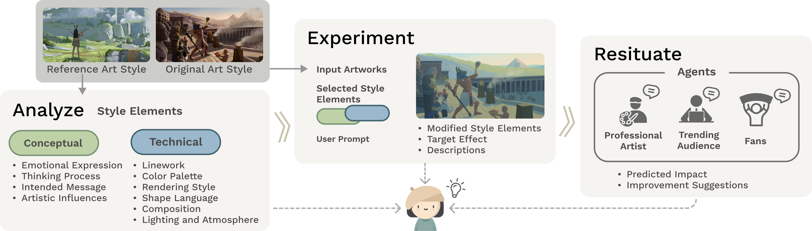

# Analyze-Experiment-Resituate (UIST'26) 

### Research Paper: "From Style Replication to Style Exploration: Enabling Art Style Exploration with Analyze-Experiment-Resituate Framework"  
> [Wen-Fan Wang](https://vannwang.com/)¹, [Tsai-Hsuan Lin](https://xup6sophia.github.io/)¹, [Chi-Lan Yang](https://www.chilanyang.space/)², An-Ru Cheng¹, [Bing-Yu Chen](https://www.csie.ntu.edu.tw/~robin/)¹     
> ¹ National Taiwan University
² University of Tsukuba
> 

<p align="left">
  <a href="https://doi.org/10.1145/3830398.3830574">
    
  </a>
  <a href="https://doi.org/10.48550/arXiv.2608.14405">
    
  </a>
</p>



## Abstract

Art style is a signature of professional digital artists that develops through repeated experimentation, reflection, and adaptation. While generative AI (GenAI) can reproduce styles with high fidelity, current tools provide limited support for exploring new stylistic directions and may encourage style replication over exploration.

To address this gap, we propose *Analyze-Experiment-Resituate (AER)*, a framework for AI-assisted style exploration derived from interviews with 10 professional digital artists. Rather than prioritizing visually appealing outputs alone, AER supports three core practices of style exploration, including interpreting references, trying out stylistic possibilities, and reflecting on how emerging styles may be received. Specifically, AER enabled artists to (1) analyze artworks into interpretable stylistic elements, (2) have controllable experimentation guided by their own choices, and (3) resituate emerging styles through simulated social perspectives.

We implemented AER in a prototype system and evaluated it in a controlled study with 16 artists. Compared with a direct style-transfer workflow, AER increased artists' agency and reflection as they pursued new stylistic directions. A two-week field study with four artists revealed how the AER framework influenced daily style exploration, such as reflection, experimentation, and stylistic decision-making at each stage. We discuss opportunities and challenges in designing AI-assisted style-exploration workflows, and outline implications for future artistic support tools.

## Setup Dependencies
### Backend
1. Make sure [conda](https://www.anaconda.com/docs/getting-started/miniconda/install) is set up.
2. Set the following environment variables in `backend/.env`:
    - `OPENAI_API_KEY`: Key for accessing OpenAI’s API.
    - `BFL_API_KEY_1`: Primary key for Black Forest Labs FLUX API (text-to-image generation).
    - `BFL_API_KEY_2`: Secondary key for FLUX API (fallback or multi-key usage for image generation).

3. Run the following commands in bash to set up the environment:
    ```bash
    conda create --name agent python=3.11.8
    conda activate agent
    cd backend
    pip install -r requirements.txt
    pip install "autogen-core" "autogen-ext[openai]" "autogen-ext[azure]" "autogen-ext[chromadb]"
    ```


### Frontend
```bash
cd frontend 
npm install
```

## To run the application

**Terminal 1 - Start FastAPI Backend:**
```bash
cd backend
conda activate agent
python app.py
```
- Server started at http://0.0.0.0:5000

**Terminal 2 - Start Next.js Frontend:**
```bash
cd frontend
npm run dev
```
- Application at http://localhost:3000

## License

This project is open source under the MIT License. See [LICENSE](LICENSE) for details.

## Citation

If you use this project in your research, please cite our UIST'26 paper:

```
@inproceedings{AER2026,
  title={From Style Replication to Style Exploration: Enabling Art Style Exploration with Analyze-Experiment-Resituate Framework},
  booktitle={Proceedings of the 39th Annual ACM Symposium on User Interface Software and Technology},
  year={2026}
}
```

---
